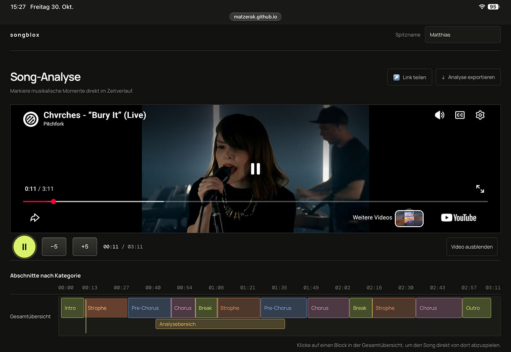

## Popsongs untersuchen – Ablaufstrukturen hörend erkunden 

### Grundidee und didaktisches Anliegen

Die Webanwendung **songblox** habe ich entwickelt, um die Untersuchung der Ablaufstruktur von Popsongs im Musikunterricht zu unterstützen. Schülerinnen und Schüler können damit eine interaktive Visualisierung der Songstruktur erstellen.

***songblox* ermöglicht es, musikalische Form als gestalteten zeitlichen Verlauf zu untersuchen.**

Ausgangspunkt war die Frage, wie sich einzelne Abschnitte eines Songs leichter miteinander vergleichen lassen. Bei Popsongs erscheint es interessant, nicht nur die Abfolge von Strophen, Refrains und weiteren Formteilen zu erkennen, sondern auch zu untersuchen, wie sich wiederkehrende Abschnitte ähneln oder voneinander unterscheiden. 

Die Anwendung soll das **vergleichende Hören** erleichtern und dazu anregen, musikalische Wiederholungen und Entwicklungen bewusster in Bezug auf ihre Wirkung zu reflektieren.

Die Einteilung in Abschnitte ist bereits eine analytische Entscheidung ist. Die Gliederung eines Songs ist dabei nicht zwangsläufig eindeutig. Schon die Entscheidung, wo Abschnitte beginnen und enden oder welche Abschnitte als gleichartig gelten, erfordert genaues Hören und musikalische Urteilsbildung.

Beim normalen Hören entfaltet sich Musik zeitlich nacheinander. Zwei Refrains können beispielsweise minutenlang auseinanderliegen. Wer sie vergleichen möchte, ist deshalb auf seine Erinnerung angewiesen. *songblox* verändert diese Situation: Die Abschnitte können **unmittelbar gegenübergestellt werden, obwohl sie im Song zeitlich voneinander getrennt sind**. Unterschiede, die beim fortlaufenden Hören möglicherweise unbemerkt bleiben, können dadurch leichter erkannt und beschrieben werden.

## Funktionsweise

Mit *songblox* lassen sich **YouTube-Musikvideos** untersuchen, die über ihre URL oder einen YouTube-Teilen-Link eingebunden werden. Ich habe die Anwendung für die Nutzung im Browser auf einem iPad optimiert. Sie lässt sich auch an einem Laptop verwenden. 

Im Zentrum steht ein **Matrixeditor** im Arbeitsbereich. Dort lassen sich an der aktuellen Position des Abspielkopfs Abschnitte anlegen und Kategorien wie Strophe, Refrain oder Bridge zuordnen. Die Abschnitte erscheinen als Streifen, die sich auf der Zeitleiste verschieben und in ihrer Länge anpassen lassen. 

Oberhalb des Editors zeigt eine **Gesamtübersicht** die angelegten Abschnitte als Blöcke (**blox**). Durch Antippen oder Anklicken eines Blocks startet die Wiedergabe an der entsprechenden Stelle. So lässt sich etwa direkt zwischen zwei Refrains hin- und herspringen, um sie wiederholt anzuhören und gezielt zu vergleichen.

Die Analyse lässt sich auch **exportieren und über einen Link teilen**. Auf diese Weise kann sie etwa auf anderen Geräten weiterbearbeitet oder auch an einem Smartboard präsentiert werden. So können Schülerinnen und Schüler ihre Ergebnisse gemeinsam betrachten, diskutieren und weiterentwickeln.

## Didaktische Überlegungen

Mit songblox möchte ich Schülerinnen und Schüler dabei unterstützen, intuitive Höreindrücke an konkreten Stellen zu überprüfen. Ein Ausgangspunkt könnte die Beobachtung sein: „Der zweite Refrain wirkt viel voller als der erste.“ 
Im unmittelbaren Vergleich lässt sich untersuchen, welche musikalischen Merkmale zu diesem Eindruck beitragen könnten – etwa zusätzliche Instrumente, Verdopplungen, Dynamik, Register oder Klangschichtung. Die Formanalyse kann so zum Ausgangspunkt einer **funktionalen Musikanalyse** werden, die nach dem Zusammenhang zwischen musikalischer Gestaltung und wahrgenommener Wirkung fragt.

Mein didaktisches Anliegen geht über die Zuordnung von Formbegriffen hinaus: **Musikalische Form soll als gestalteter zeitlicher Verlauf untersucht werden.** Was kehrt wieder? Was verändert sich? Wie werden Erwartungen aufgebaut? Welche Funktion erfüllt ein Abschnitt im gesamten Song? Wenn etablierte Formbegriffe für ein Musikstück wenig hilfreich sind, können auch andere Gliederungen erprobt und begründet werden.

Schon die Einteilung in Abschnitte ist eine analytische Entscheidung. Wo ein Abschnitt beginnt oder endet und welche Passagen derselben Kategorie zugeordnet werden, ist nicht immer eindeutig. Diese Entscheidungen erfordern genaues Hören und musikalische Urteilsbildung. Daraus ergeben sich Fragen wie:
- Wann gilt ein Refrain als Wiederkehr desselben Formteils, obwohl sich seine Instrumentierung verändert?
- Welche musikalischen Merkmale sprechen dafür, einen neuen Abschnitt anzunehmen?
- Was unterscheidet eine Wiederholung von einer Variation?
- Können zwei Personen denselben Song plausibel unterschiedlich gliedern?

Die dargestellte Ablaufstruktur wird damit als Ergebnis musikalischer Interpretation diskutierbar. Die Lernenden erkennen Abschnitte, vergleichen sie, beschreiben Unterschiede und deuten deren Bedeutung für den musikalischen Verlauf.

Als ergänzenden Impuls zum Thema Songstrukturen verlinke ich das YouTubevideo Every Type of Song Structure Explained.

## Gestaltungsentscheidungen

Bei der Entwicklung war mir eine übersichtliche und unmittelbar bedienbare Oberfläche wichtig. Ich habe songblox gezielt auf die Untersuchung der Ablaufstruktur von Popsongs ausgerichtet. Die Anwendung soll das **eigenständige, vergleichende und reflektierte Hören** unterstützen.

Die Schülerinnen und Schüler können mit **songblox** die Songs für ihre Analyse selbst auswählen und ihre Ergebnisse teilen, um Rückmeldungen einzuholen und unterschiedliche Deutungen zu besprechen.

Die Bedienung ist auf **Touch** ausgelegt; die zentralen Analysefunktionen lassen sich ohne Tastatur nutzen. Beim Wechsel im Matrixeditor wird die Musikwiedergabe automatisch angehalten.

Eine weitere bewusste Entscheidung betrifft die Möglichkeit, das **Video auch ausblenden** zu können, um die Aufmerksamkeit auf unterschiedliche Ebenen des musikalischen Geschehen und die hörbaren Unterschiede zwischen Abschnitten zu richten.

Die **Aufgabenstellung lässt sich über eine Markdown-Datei anpassen**. Dazu muss die Webanwendung selbst gehostet werden. 

Außerdem lässt sich die **Schriftgröße vergrößern**, um die Lesbarkeit insbesondere für Menschen mit eingeschränktem Sehvermögen zu verbessern. Eine umfassende Barrierefreiheit ist damit noch nicht nachgewiesen.

## Kurzanleitung

1. **Videolink kopieren:** Öffne ein Popsong-Video auf YouTube. Wähle unter dem Video **Teilen** und anschließend **Kopieren**.
2. **Video laden:** Wechsle zu songblox. Wähle **Hier klicken, um Videolink einzufügen**, anschließend **Einfügen** und dann **Video laden**.
3. **Abschnitte anlegen und bearbeiten:** Füge im Arbeitsbereich über **+ Abschnitt am Abspielkopf** einen Abschnitt an der aktuellen Wiedergabeposition hinzu. Ordne ihn einer Kategorie zu. Durch Antippen bzw. Anklicken und Ziehen kannst du seine Zuordnung, Position und Länge verändern.
4. **Abschnitte vergleichen:** Tippe oder klicke in der Gesamtübersicht auf einen Block, um die Wiedergabe an der entsprechenden Stelle zu starten. Wechsle zwischen den Blöcken, um Abschnitte direkt miteinander zu vergleichen.
5. **Abschnitte löschen:** Lösche nicht benötigte Abschnitte in der Tabelle unterhalb des Matrixeditors.
6. **Ansicht anpassen:** Blende das Video oder die Aufgabenstellung über die zugehörigen Schaltflächen aus, wenn du sie gerade nicht benötigst.
7. **Ergebnisse teilen und exportieren:** Nutze **Link teilen**, um die Analyse weiterzugeben, oder **Analyse exportieren**, um sie als Datei zu sichern. Die Funktionsbuttons finden sich oben auf der Seite.

## Unterrichtliche Einsatzmöglichkeiten

Die Webanwendung *songblox* unterstützt unterschiedliche Lernprozesse: von der Beschreibung musikalischer Formabschnitte über die Analyse wiederkehrender und variierter Strukturen bis hin zur begründeten Beurteilung unterschiedlicher Gliederungsmöglichkeiten.

### Lernziele

Die Schülerinnen und Schüler können …

- die Ablaufstruktur eines Popsongs hörend erschließen und unter Verwendung geeigneter Fachbegriffe beschreiben,
- musikalische Formabschnitte anhand hörbarer Merkmale unterscheiden und ihre Gliederungsentscheidungen begründen,
- wiederkehrende Abschnitte hinsichtlich ihrer musikalischen Gestaltung vergleichen und Unterschiede sowie Veränderungen analysieren,
- die Funktion musikalischer Abschnitte für den Gesamtverlauf erläutern,
- unterschiedliche Möglichkeiten der Formgliederung vergleichen und hinsichtlich ihrer Plausibilität beurteilen.

### Beispielhafte Arbeitsaufträge

**1. Wie ist ein Popsong aufgebaut? – Ablaufstrukturen untersuchen**

Untersuche die Ablaufstruktur eines selbst gewählten Popsongs mithilfe von *songblox*.

- Erstelle eine Gliederung des Songs in musikalisch sinnvolle Abschnitte und ordne ihnen geeignete Formbezeichnungen zu.
- **Beschreibe** den Ablauf des Songs anhand deiner Visualisierung.
- **Begründe** deine Gliederungsentscheidungen an ausgewählten Übergängen anhand hörbarer musikalischer Merkmale.

*Schwerpunkt: musikalische Form erkennen, beschreiben und begründet gliedern.*

**2. Wiederholung oder Variation? – Formabschnitte vergleichen**

**Vergleiche** zwei wiederkehrende Abschnitte eines Popsongs, beispielsweise den ersten und zweiten Refrain.

- **Analysiere** Gemeinsamkeiten und Unterschiede hinsichtlich ausgewählter musikalischer Gestaltungsmittel (z. B. Instrumentation, Rhythmik, Melodik, Dynamik oder Klangschichtung).
- **Erläutere**, welche Bedeutung die festgestellten Veränderungen für die musikalische Entwicklung und die wahrgenommene Wirkung des Songs haben.

Nutze die direkte Wiedergabe der Abschnitte in *songblox*, um deine Beobachtungen an konkreten Hörstellen zu belegen.

*Schwerpunkt: vergleichende Analyse und funktionale Deutung musikalischer Gestaltung.*

**3. Hat ein Song nur eine Form? – Gliederungen vergleichen und beurteilen**

Untersucht denselben Popsong unabhängig voneinander und erstellt jeweils eine Ablaufstruktur mit *songblox*. Tauscht anschließend eure Ergebnisse über die Teilen-Funktion aus.

- **Vergleicht** eure Gliederungen hinsichtlich der Abschnittsgrenzen und Formbezeichnungen.
- **Erläutert**, welche musikalischen Merkmale jeweils für eure Entscheidungen sprechen.
- **Beurteilt**, welche Gliederung den hörbaren musikalischen Verlauf überzeugender abbildet oder inwiefern mehrere Gliederungen plausibel sind.

*Schwerpunkt: musikalische Urteilsbildung und Reflexion analytischer Entscheidungen.*

### Didaktischer Hinweis

Die Aufgaben bauen in ihren Anforderungen aufeinander auf, können aber auch unabhängig voneinander eingesetzt werden.

Dabei steht nicht die schematisch richtige Benennung möglichst vieler Formabschnitte im Mittelpunkt. Vielmehr sollen die Lernenden musikalische Strukturen hörend erschließen, ihre Beobachtungen fachsprachlich beschreiben und ihre analytischen Entscheidungen begründen.

Die mit *songblox* erstellte Visualisierung ist somit nicht nur ein Ergebnis der Analyse, sondern zugleich eine Grundlage für das weitere vergleichende Hören, die Diskussion und die Reflexion musikalischer Form.

## Technische Voraussetzungen, Datenschutz und Lizenz

### Nutzung und Hosting

*songblox* wird im Browser verwendet und bindet Videos von YouTube ein. Für deren Wiedergabe ist eine Internetverbindung erforderlich. Die Verfügbarkeit eines Videos in *songblox* hängt auch davon ab, ob YouTube dessen Einbettung zulässt.

Wer die Aufgabenstellung anpassen möchte, benötigt eine eigene Bereitstellung der Anwendung mit Zugriff auf die entsprechende Markdown-Datei.

### Datenschutz

Die Einbindung von YouTube bedeutet, dass ein externer Dienst genutzt wird. Dabei können personenbezogene Daten an Google bzw. YouTube übermittelt und Cookies oder ähnliche Technologien eingesetzt werden. Weitere Informationen enthält die Datenschutzerklärung von Google.

Ein in *songblox* eingegebener Spitzname wird im Teilen-Link und in der Exportdatei festgehalten. Beim Weitergeben der Analyse wird damit auch diese Angabe weitergegeben.

Welche weiteren Daten *songblox*, eingebundene Dienste oder der Hosting-Anbieter verarbeiten, lässt sich nur anhand der konkreten technischen Umsetzung bestimmen. Aussagen wie „Es werden ausschließlich Spitznamen erhoben“ oder „Alle Daten bleiben auf dem eigenen Gerät“ lassen sich daraus nicht ableiten. Die vorliegende Beschreibung ersetzt daher keine auf die veröffentlichte Anwendung abgestimmten Datenschutzhinweise.

### Entwicklung und Lizenz

Den Quellcode habe ich mithilfe von ChatGPT erstellen lassen. Ausgehend von meiner didaktischen Idee habe ich die Anwendung in einem iterativen Prozess durch zahlreiche Anpassungen und Tests weiterentwickelt.

Mit der Veröffentlichung möchte ich zugleich den Quellcode zugänglich machen und zur Auseinandersetzung mit der Anwendung einladen. Die Entstehung mithilfe von KI ist für sich genommen keine Aussage über die Fehlerfreiheit oder Lizenzierung des Codes. Eine konkrete Lizenz wird in dieser Beschreibung nicht festgelegt; die Bedingungen für die Nutzung und Weiterentwicklung des Quellcodes sind gesondert im Repository anzugeben.

### Ausprobieren und Mitentwickeln

Ich freue mich über Erfahrungsberichte aus dem Unterricht, Hinweise auf Fehler und Vorschläge zur Weiterentwicklung.

